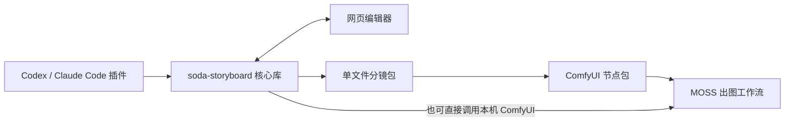

# soda-storyboard

soda-storyboard 帮你把一段故事整理成可编辑的漫画分镜，再交给图像模型 MOSS 画出来。


这是随仓库提供的「起身舒展」示例：25 岁原创女主绯音结束工作，起身伸展，再邀请同伴喝点东西。五格从右向左阅读，右侧竖向主格完整展示舒展姿态，暖金灯光与冷紫帘幕衬托黑长发和酒红礼服。角色外观由文字提示词定义，**无参考图输入、无角色 LoRA**；三句中文台词由程序后期排字。

从 [第一页教程](docs/guide/03-first-page.md) 开始；想从空目录练习时，直接照着其中的[“两句话、两格”主线](docs/guide/03-first-page.md#独立路线两句话两格从空目录开始)。也可以直接使用 [示例项目](examples/stretch-color/)、[分镜包](examples/stretch-color/exports/stretch-color.storyboard.json) 和 [ComfyUI 工作流](examples/stretch-color/workflows/stretch-color.workflow.json)。它们对应上面这张成图。



你可以在 Codex 或 Claude Code 里和 AI 商量怎么拆格，也可以打开网页编辑器，自己摆人物、改台词。核心库负责保存、预览和编译；插件教 AI 怎样调用它；[ComfyUI 节点包](https://github.com/cOkieeman/ComfyUI-Soda-Storyboard)负责接收分镜包、预览内容和连接出图工作流。分镜包带页面、角色卡和项目设置，模型文件使用你本机已有的。

## 插件怎么用

下面从已有彩色示例开始。命令均在下载后的仓库根目录运行，项目目录是 `examples/stretch-color`，页 id 是 `stretch-color`，角色 id 是 `hiyone`。

1. 安装命令行工具。准备 Python 3.12+ 和 [uv](https://docs.astral.sh/uv/) 后运行，网页编辑器也会一起装好，无需另装 Node。

   ```powershell
   uv tool install https://github.com/cOkieeman/soda-storyboard/releases/download/v0.4.2/soda_storyboard-0.4.2-py3-none-any.whl
   soda-storyboard --help
   ```

2. 启用插件。插件在本仓库的 `skill/` 目录中：Codex 使用本地市场 `soda-storyboard-local`，Claude Code 可以用 `claude --plugin-dir "<仓库路径>/skill"` 临时加载。完整步骤见 [安装章](docs/guide/02-installation.md)，装好后开一个能选到技能的新聊天。

3. 让插件先读已有项目，再讨论修改。例如：

   > 用 soda-storyboard 打开 examples/stretch-color 的 stretch-color 页，先读项目、页文件和 hiyone 角色卡。保持绯音的外观和五格剧情，先带我看草稿，再教我改第三格的舒展姿态。

   

   阅读顺序是右上结束工作 → 左上起身 → 右侧全身伸展 → 左中表情特写 → 左下邀请同伴。草稿中的青色人物用于摆构图和动作，角色外观在 [角色卡](examples/stretch-color/characters/hiyone.json) 中定义。新故事可以先让 AI 提供拆格和版式方案；已有示例不用重新创建。

4. 草稿想改时，直接告诉 AI，或让它打开网页编辑器。点格子改画面描述，点人物拖关节，点文字框改台词。等“已保存”后，告诉 AI：“我在网页里改过了，重新读文件再继续。”

   ```powershell
   soda-storyboard edit examples/stretch-color --detach --page stretch-color --json
   ```

   

   骨架帮助说明姿态，握腕、视线和表情等细节也需要写进画面描述。人物的发型、眼睛、服装款式和颜色保存在角色卡里，各格共用。

5. 整页满意后，告诉 AI：“就按这版，补齐英文场景译文，台词保留中文，再编译和导出分镜包。”示例已包含可用译文；改过中文场景时，先让 AI 处理 `translate --todo` 列出的待办，再通过 `--apply` 写回。

   ```powershell
   soda-storyboard translate examples/stretch-color/pages/stretch-color.json --todo --json
   soda-storyboard compile examples/stretch-color/pages/stretch-color.json --output examples/stretch-color/output/stretch-color.moss.json --json
   soda-storyboard export-bundle examples/stretch-color/pages/stretch-color.json --json
   ```

   上面的待办命令用于检查，不会自动翻译；有待办时先补译再编译。导出得到 `examples/stretch-color/exports/stretch-color.storyboard.json`。角色英文描述可单独查看 [character-prompt.txt](examples/stretch-color/output/character-prompt.txt)。

6. 按下面的节点用法打开配套工作流，上传这个分镜包、选择本机模型，再运行一张。工作流完成 MOSS 整页生成、中文气泡排字和保存图片。

   

   对比图展示同一彩色案例的本地草稿与生成并排字后的成图。分镜和角色卡可直接编辑；出图结果仍会受模型版本、种子和提示词影响。

拆格、草稿和网页编辑都能离线做，生成图片才需要 ComfyUI 和模型。用完编辑器后，可以让 AI 运行 `soda-storyboard edit examples/stretch-color --stop --json` 关闭后台服务。

## 用配套节点工作流出图

1. 将节点仓库 [ComfyUI-Soda-Storyboard](https://github.com/cOkieeman/ComfyUI-Soda-Storyboard) 放到 `ComfyUI/custom_nodes/ComfyUI-Soda-Storyboard`。插件用于讨论和编辑分镜，在 ComfyUI 出图还需要这个节点包。
2. 给 ComfyUI 使用的 Python 安装核心 wheel，然后重启。Windows 便携版在 `ComfyUI_windows_portable` 根目录运行：

   ```powershell
   .\python_embeded\python.exe -m pip install --upgrade "https://github.com/cOkieeman/soda-storyboard/releases/download/v0.4.2/soda_storyboard-0.4.2-py3-none-any.whl"
   ```

   普通安装使用启动 ComfyUI 的那个 Python。完整安装与版本要求见 [安装章](docs/guide/02-installation.md)。

3. 在 ComfyUI 按 **Ctrl+O**，打开 `examples/stretch-color/workflows/stretch-color.workflow.json`。再将 `examples/stretch-color/exports/stretch-color.storyboard.json` 拖到“导入分镜”的预览区，或点“上传”。**打开工作流后仍要上传分镜包**，其他电脑的 ComfyUI 输入副本不会随工作流一起出现。
4. 核对导入节点显示 **1024×1536、5 格、3 句台词、英文译文新鲜、本页不使用 LoRA**。在“分镜图／提示词／逐格”中检查内容，点“查看”可以放大。

   

5. 在原生 `UNETLoader`、`CLIPLoader`、`VAELoader` 中重新选择本机的 MOSS SFT、qwen3.5 编码器和 flux2 VAE；编码器类型选 `moss_image`。本例使用 MOSS-Image SFT INT8、qwen3.5_9b_w4a8_gptq、flux2-vae，没有 LoRA Loader 和图片条件输入。
6. 确认批次数量为 1，再点“运行”。本次成图参数已保存在工作流中：

   | 项目 | 本例设置 |
   | --- | --- |
   | 画布 | 1024×1536 |
   | 质量档 | Quality，50 步 |
   | CFG | 3 |
   | 采样器 / 调度器 | euler / simple |
   | SLG | 单层 22 |
   | 种子 | 20261022 |
   | 台词 | 程序排字，中文竖排 |

   这张图在本机一次运行约 **102.5 秒**，硬件、模型版本和排队情况会影响速度与结果。本页都是矩形格，解码后直接经过 `SodaLetterPage` 排字，再保存图片，保留模型生成的格框。

修改原项目后，需要补译变更的场景、重新导出并上传分镜包，下一次采样才会使用新内容。ComfyUI 上传的文件是副本，不会随原项目自动更新。更多节点操作见 [彩色分镜节点教程](https://github.com/cOkieeman/ComfyUI-Soda-Storyboard/blob/main/docs/tutorial-stretch-color.md)。

### 可选：让插件直接调用 ComfyUI

也可以配置本机 ComfyUI 后，让插件通过 CLI 生成候选、选图、拼页、排字和导出 PNG / PDF，见 [出图和后期](docs/guide/07-generation.md)。CLI `final` 的基础采样参数同样是 50 步、CFG 3、Euler / simple 与 SLG 22；上面的图实际由配套节点工作流运行，任务记录和后处理由各自流程管理，节点保存的图片不会自动登记为 CLI 候选。

## 完整说明

从 [中文使用说明目录](docs/guide/README.md) 继续：[安装](docs/guide/02-installation.md) · [第一页](docs/guide/03-first-page.md) · [角色卡](docs/guide/04-characters.md) · [编辑器](docs/guide/05-editor.md) · [提示词](docs/guide/06-prompts.md) · [出图后期](docs/guide/07-generation.md) · [ComfyUI](docs/guide/08-comfyui.md) · [排错](docs/guide/10-troubleshooting.md) · [命令速查](docs/guide/11-cli-reference.md)。

本例已使用正式发布的 **soda-storyboard 0.4.1** 验证，0.4.2 同样适用；安装示例使用最新的 0.4.2 wheel。源码后续变化见 [更新记录](CHANGELOG.md)。

开发者可看 [开发与验证](docs/development.md)、[分镜包 API](docs/bundle-api.md)、[schema](schema/storyboard-v1.schema.json)。让其他 AI 输出可导入分镜，使用 [格式说明](docs/for-other-ai.md)。插件流程与来源见 [SKILL](skill/skills/soda-storyboard/SKILL.md) 和 [NOTICE](NOTICE)。

## English

soda-storyboard turns a short story into an editable comic storyboard. Plan panels with the Codex / Claude Code plugin, adjust figures and text in the bundled web editor, then export a single-file storyboard bundle for local ComfyUI. The [companion nodes](https://github.com/cOkieeman/ComfyUI-Soda-Storyboard) preview the bundle and connect it to MOSS workflows. The included [full-color example](examples/stretch-color/) uses text-only character descriptions and program-rendered Chinese lettering, with no reference-image input or LoRA. Its 50-step SLG workflow is separate from the optional CLI generation presets. This example was verified with the released 0.4.1 wheel. Python 3.12+ is required; the wheel includes the editor. See the [Chinese guide](docs/guide/README.md).
