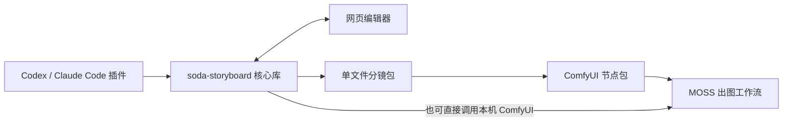
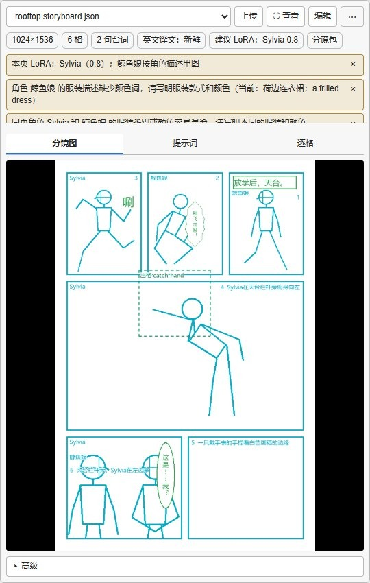

# soda-storyboard

soda-storyboard 帮你把一段故事整理成漫画分镜，再交给图像模型 MOSS 画出来。



你可以在 Codex 或 Claude Code 里和 AI 商量怎么拆格，也可以打开网页编辑器，自己摆人物、改台词。想去 ComfyUI 调参数时，把这一页导出成一个**分镜包**就能交过去。分镜包里有页面、角色卡和项目设置，模型文件仍使用你本机已有的。

上图中的核心库负责实际的保存、预览和编译。插件教 AI 怎样调用它；另一个仓库的 ComfyUI 节点包则负责接收文件、展示分镜和连接出图工作流。


天台故事的草稿、整页出图和排字成品。生成图均为 draft 档实测，取自不同轮次。

## 插件怎么用

第一次用，可以跟着下面的顺序做。示例的故事目录叫 `my-project`，页 id 是 `rooftop`；让 AI 保存时沿用这两个名字，后面的命令就能对上。命令均在故事目录的上一级运行。

1. 安装命令行工具。准备好 Python 3.12+ 和 [uv](https://docs.astral.sh/uv/) 后运行下面两条命令，网页编辑器也会一起装好，无需另装 Node。

   ```powershell
   uv tool install https://github.com/cOkieeman/soda-storyboard/releases/download/v0.4.0/soda_storyboard-0.4.0-py3-none-any.whl
   soda-storyboard --help
   ```

2. 启用插件。下载本仓库后，插件就在 `skill/` 目录里：Codex 使用本地市场 `soda-storyboard-local`，Claude Code 可以用 `claude --plugin-dir "<仓库路径>/skill"` 临时加载。两种宿主的完整步骤见 [安装章](docs/guide/02-installation.md)，装好后开一个能选到技能的新聊天。

3. 把故事贴给 AI，告诉它：“用 soda-storyboard 做成一页漫画，先给我几种拆法，台词留到最后排。”它会和你选画风、拆格和版式，等你看过整页草稿再出图；已经决定好的部分不用反复确认。

   

   同一页可以试不同版式。这些候选由本地工具绘制，不消耗出图次数。

4. 草稿有想改的地方，可以直接告诉 AI，也可以说“打开这一页的网页编辑器”，自己拖人物、挪文字框。网页保存后，让 AI 重新读一下页文件，再接着改。

   ```powershell
   soda-storyboard edit my-project --detach --page rooftop --json
   ```

   

   编辑器：1 工具条，2 页面与角色，3 画布，4 检查器，5 最终提示词，6 已有出图条。

5. 整页满意后，告诉 AI：“就按这版，补齐英文提示词，台词保留中文。”它会通过 `translate --todo` / `--apply` 补译场景，再用 `compile` 整理成 MOSS JSON。

   ```powershell
   soda-storyboard translate my-project/pages/rooftop.json --todo --json
   soda-storyboard compile my-project/pages/rooftop.json --output my-project/output/rooftop.moss.json --json
   ```

6. 按 [安装章](docs/guide/02-installation.md) 连接 ComfyUI，运行 `comfy check --project my-project` 检查节点和模型，然后告诉 AI 要出几张，比如“出 4 张 draft 候选”。挑好一张后，就可以修细节、拼页、排字并导出 PNG / PDF，完整过程见 [第一页教程](docs/guide/03-first-page.md)。

   ```powershell
   soda-storyboard gen page rooftop --project my-project --seeds 4 --preset draft --lora auto --json
   # 看完候选，把 render.png 换成返回的已登记图片路径，再继续
   soda-storyboard pick rooftop render.png --project my-project --json
   soda-storyboard compose rooftop --project my-project --json
   soda-storyboard letter rooftop --project my-project --json
   soda-storyboard export rooftop --project my-project --format png --json
   soda-storyboard export my-project --format pdf --json
   ```

   

   draft 档实测候选，可以放在一起比较构图和动作。

7. 如果想留到 ComfyUI 自己出图，就对 AI 说“导出这一页的分镜包”，把得到的 `exports/rooftop.storyboard.json` 拖进“导入分镜”节点即可。编辑器用完后，也可以让 AI 关闭后台服务。

   ```powershell
   soda-storyboard export-bundle my-project/pages/rooftop.json --json
   soda-storyboard edit my-project --stop --json
   ```

拆格、草稿和网页编辑都能离线做，到了生成图片这一步才需要 ComfyUI 和模型。

## ComfyUI 节点怎么用

1. 将节点仓库 [ComfyUI-Soda-Storyboard](https://github.com/cOkieeman/ComfyUI-Soda-Storyboard) 放到 `ComfyUI/custom_nodes/ComfyUI-Soda-Storyboard`。用 ComfyUI 做图时，装的是这个节点包。
2. 给 ComfyUI 使用的 Python 安装核心 wheel，然后重启。Windows 便携版在 `ComfyUI_windows_portable` 根目录运行下面的命令；wheel 已经构建好，便携版可以直接安装。

   ```powershell
   .\python_embeded\python.exe -m pip install --upgrade "https://github.com/cOkieeman/soda-storyboard/releases/download/v0.4.0/soda_storyboard-0.4.0-py3-none-any.whl"
   ```

   普通 Python 安装则用启动 ComfyUI 的那个解释器安装同一个 wheel。便携版安装说明见 [安装章](docs/guide/02-installation.md)。

3. 把整页示例 [minimal_page.json](https://github.com/cOkieeman/ComfyUI-Soda-Storyboard/blob/main/example_workflows/minimal_page.json) 拖进 ComfyUI，连线就准备好了。接着把分镜包拖到“导入分镜”预览区，或点“上传”；手里只有裸分镜单或 MOSS JSON，也能从这里导入。
4. 在“分镜图 / 提示词 / 逐格”里核对草稿、描述和台词，点“查看”可以放大。顶部会列出尺寸和译文状态，有需要处理的地方会显示黄色提醒；外来 MOSS 没有格子时，则显示“单画布”和条目列表。

   

   导入节点预览组件，载入的是 draft 档实测分镜包；截图在离线环境中打开。

5. 在原生 Loader 里选择自己电脑上的 MOSS SFT / Base、qwen3.5 编码器和 flux2 VAE。要用人物 **LoRA**（辅助保持角色外观的小模型），就在 `LoraLoaderModelOnly` 中手选文件和强度，一次一个；不用则旁路，示例不会自动套用节点给出的建议。
6. 文件选好后运行整页工作流。以后只想重画一格，可以换 `panel_redraw.json`；要按人物区域修细节，用 `character_swap.json`，全部节点的说明见 [节点 README](https://github.com/cOkieeman/ComfyUI-Soda-Storyboard#使用方法)。

## 完整说明

从 [中文使用说明目录](docs/guide/README.md) 继续：[安装](docs/guide/02-installation.md) · [第一页](docs/guide/03-first-page.md) · [角色卡](docs/guide/04-characters.md) · [编辑器](docs/guide/05-editor.md) · [提示词](docs/guide/06-prompts.md) · [出图后期](docs/guide/07-generation.md) · [ComfyUI](docs/guide/08-comfyui.md) · [排错](docs/guide/10-troubleshooting.md) · [命令速查](docs/guide/11-cli-reference.md)。

说明按当前仓库 **0.4.1 待发布代码** 编写；安装示例使用已发布的 **0.4.0 wheel**。本页 LoRA 策略、服装提醒和新版场景译文需要升级到含相应修复的版本，详见 [更新记录](CHANGELOG.md)。

开发者可看 [开发与验证](docs/development.md)、[分镜包 API](docs/bundle-api.md)、[schema](schema/storyboard-v1.schema.json)。让其他 AI 输出可导入分镜，使用 [格式说明](docs/for-other-ai.md)。插件流程与来源见 [SKILL](skill/skills/soda-storyboard/SKILL.md) 和 [NOTICE](NOTICE)。

## English

soda-storyboard turns a short story into an editable comic storyboard. Use the Codex / Claude Code plugin to plan panels, adjust figures and text in the bundled web editor, then export a single-file storyboard bundle or generate through local ComfyUI. The [companion nodes](https://github.com/cOkieeman/ComfyUI-Soda-Storyboard) preview the bundle and connect it to MOSS workflows. Python 3.12+ is required; the wheel includes the editor. See the [Chinese guide](docs/guide/README.md) for the full workflow.
