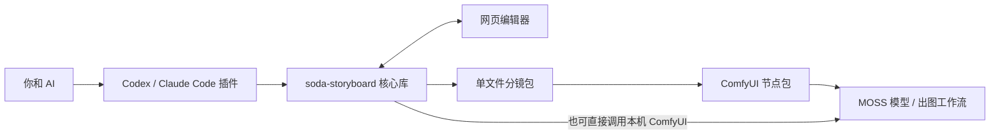

# 1. 这是什么

一页有几格、人物站在哪边、台词放哪里，这些安排都可以在出图前改。soda-storyboard 把它们保存在分镜单里，并画成一张带火柴人的草稿。你和 AI 讨论时有图可看，调整好以后，这份分镜单也能继续交给模型出图。

平时在 Codex 或 Claude Code 里聊故事，用到的是**插件**。它告诉 AI 怎样和你讨论分镜、什么时候展示候选、哪些地方需要等你确认。AI 调用的保存、校验、预览和编译命令，都来自 Python **核心库**。

如果你更习惯在 ComfyUI 里出图，就把定好的页面导出成**分镜包**。这个 JSON 文件装着当前页、出场角色卡、项目设置和可选的草稿缩略图。装在 ComfyUI 中的**节点包**可以读取它，展示预览，再把提示词接进工作流。包里不包含模型或参考照片，模型仍按你在 ComfyUI 里的配置使用。

「起身舒展」的本地分镜草稿与彩色成图。角色由文字提示词定义，MOSS 生成图像后由程序加入中文台词；[第一页教程](03-first-page.md)会用这一页讲解插件与节点的配合。

## 选一种用法

| 你手里有什么 | 从哪里开始 | 需要安装什么 |
| --- | --- | --- |
| 只有故事，想和 AI 一起做 | 插件讨论 → 网页修改 → 出图或导出包 | 核心库和插件；出图时再准备 ComfyUI |
| 已有分镜包或 MOSS JSON | ComfyUI 导入节点 → 查看 → 工作流出图 | 节点包、核心 wheel、模型；无需 AI 宿主插件 |
| 想用 AI 规划，在 ComfyUI 调参数 | 插件做页 → 导出分镜包 → 节点接手 | 两边都安装 |

如果你愿意自己管理文件，也可以直接使用命令行和网页编辑器。拆格、角色卡、草稿和编辑都能离线完成，只有生成图片时需要运行 ComfyUI。

## 先认识几个词

- **分镜**：把故事拆成一格一格，让读者按顺序看懂发生了什么。
- **景别**：看得多近。全景看动作，特写看表情或某个细节。
- **MOSS**：这里使用的图像模型，能读取带位置框的画面描述。
- **caption**：给模型看的画面描述；台词原文另存在 `text` 中。
- **LoRA**：给图像模型附加的小模型，这里可用来辅助保持某个角色的外观。没有 LoRA 也能画。
- **编译**：把分镜单整理成 MOSS 能读取的布局 JSON，不会因此开始出图。

做第一页时，选一件小事就够了，比如丢了东西、接住一张纸，或者发现一个误会。让 AI 提几个拆法，再看哪个读起来顺。默认的日漫顺序从右往左读，文字横排还是竖排可以另外选择。

[下一章：安装](02-installation.md) · [返回目录](README.md)
