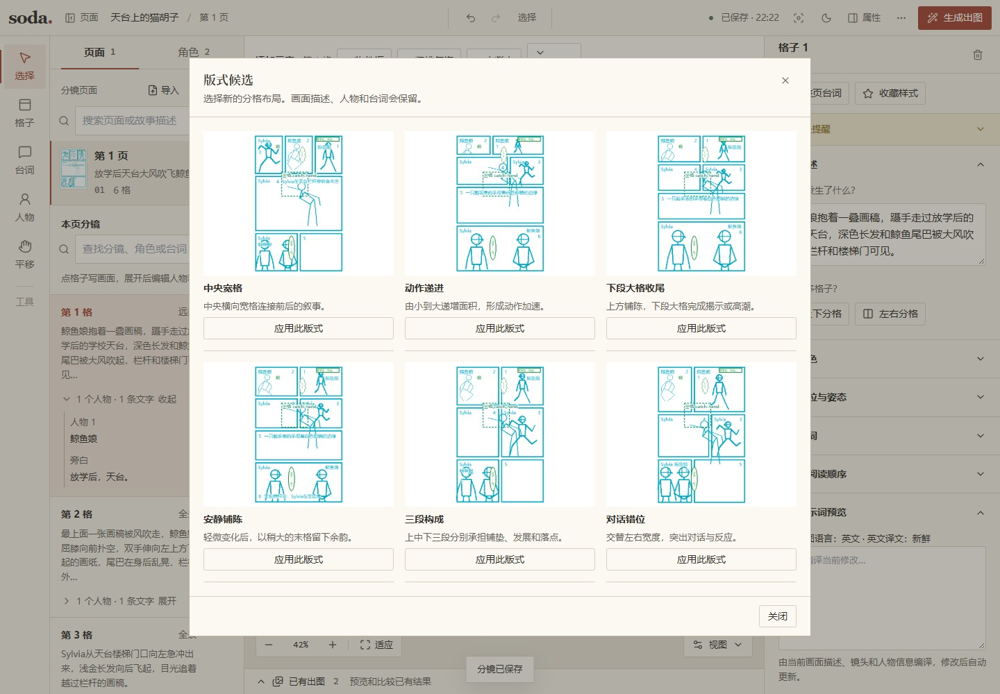
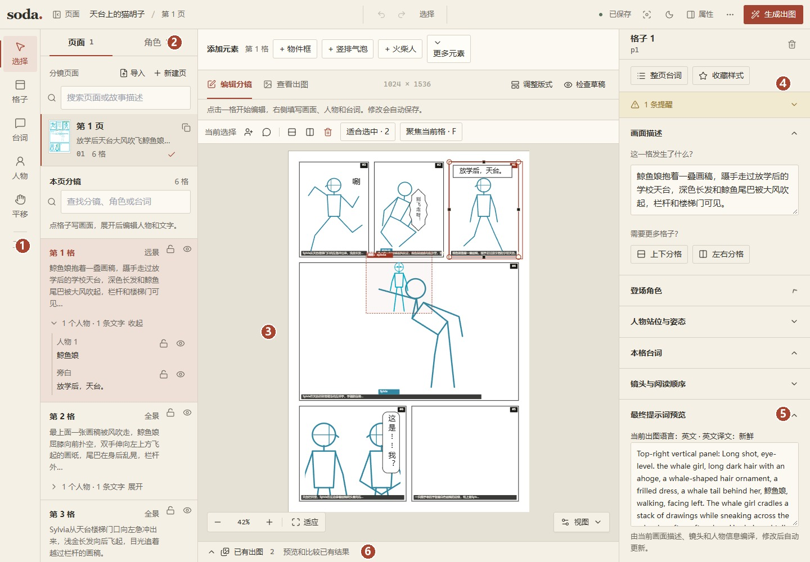
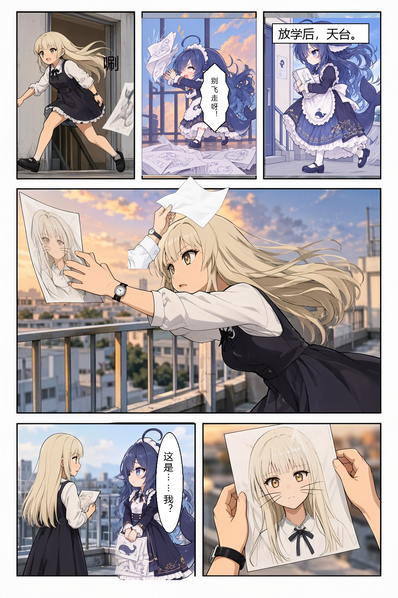

# 3. 十分钟做出第一页

这一页画的是放学后的一件小事：

> 天台上的风吹飞了鲸鱼娘的画稿。Sylvia 伸手抓回来，却发现画上的自己长着猫胡子。两人尴尬地对视。

我们就用它走一遍：和 AI 商量怎么画，调整草稿，选一张成图，最后加上台词。下载模型和等待生成的时间要另算，实际耗时取决于你的环境。

下面以插件对话为主，对应的命令收在可展开的说明里。示例项目放在 `~/comics/my-project`，页 id 用 `rooftop`；手动执行命令时，从项目的上一级目录运行。如果换了名字，记得一起替换命令里的目录和 id。

## 1. 把故事交给插件

在加载了插件的新聊天里贴上故事，接着说：

> 用 soda-storyboard 把这个故事做成一页漫画。先给我选画风和拆格方案，台词等画面出来以后再排。

为了和本章的命令对上，让 AI 保存为 `my-project`，页 id 为 `rooftop`，角色 id 分别为 `sylvia` 和 `whale`。这里选择后期排字，对应的设置叫 `dialogue_mode: lettering`。

画风可以按自己的喜好选。示例用的是清爽二维赛璐珞：清楚的线条、平涂、克制的亮色。选定后，AI 会把英文画风描述存进项目，后面的格子共用它。

两个人的外观也在这时说清楚。Sylvia 是浅金长直发，穿白色长袖衬衫和深色背心裙，戴手表；鲸鱼娘有深色长发、鲸鱼头饰和尾巴，穿浅蓝色荷叶边吊带连衣裙。这一轮可以不加 LoRA，角色卡的详细写法在 [下一章](04-characters.md)。

## 2. 选拆格，再选版式

这个故事的笑点在画上的猫胡子，前面需要留几格，把画稿怎么飞走、又怎么被接住交代清楚。示例用了六格：

1. 鲸鱼娘抱着画稿走过天台，带出人物和地点。
2. 风吹走最上面一张，她伸手扑空。
3. Sylvia 冲出来，把读者的视线带到另一人身上。
4. Sylvia 抓住画稿。关键动作放在这一页的大格里。
5. 画稿特写，露出猫胡子。
6. 两人对视，让反应多停一拍。

你不必照搬六格。如果觉得接画稿的动作太赶，可以让 AI 多拆一格；想把重点留给最后的尴尬，也可以压缩前面的过程。选好拆法以后，插件才会拿出几种版式供你比较。



同一故事的六种版式预览，由本地工具绘制。

版式决定这一页哪里紧、哪里松，以及读者会在哪格停一下。比如你可以说：“第四格大一点，最后两格留给反应。”选定一版后，AI 会保存格子和文字的位置。

<details>
<summary>手动查看版式候选</summary>

```powershell
soda-storyboard layout suggest --panels 6 --candidates 6 --direction rtl --width 1024 --height 1536 --preview-dir my-project/previews/candidates --json
```

这里只预览候选，所以没有传 `--page`。带上它会直接写回页文件，应在选好版式后使用。

</details>

## 3. 看草稿，改位置


天台页的火柴人草稿。青色是格子和格内人物，绿色是文字框，红色用于标题或跨格人物。

草稿不用画得好看，但应该能读懂：画稿往哪边飞，谁在接，两人最后能不能对上视线。台词的位置也可以在这时试，看看有没有压到脸或挡住关键动作。

想改某一处，直接说具体位置和动作就行：

> 第二格让鲸鱼娘向左伸手，其他格子保持原样。

AI 改完会再给一张草稿。草稿定的是构图，人物表情和细节要等成图后看。

<details>
<summary>校验页面并生成草稿</summary>

```powershell
soda-storyboard validate my-project/pages/rooftop.json --json
soda-storyboard preview my-project/pages/rooftop.json --output my-project/previews/rooftop.png --json
```

`validate` 会检查几何和角色引用，`preview` 把当前安排画出来，便于发现位置问题。

</details>

## 4. 打开编辑器，自己拖一拖

有些调整直接拖会更快。对 AI 说“打开这一页的网页编辑器”，浏览器就会打开当前页。



编辑器中的天台页，选中格子后，右侧会显示这一格的内容。

点格子可以改描述，点人物可以换姿势、朝向或拖关节，点文字则能改台词和框的位置。具体操作见 [网页编辑器](05-editor.md)。

网页和 AI 共用一份页文件。自己拖完后，等界面显示保存完成，再告诉 AI：“我在网页改过了，重新读一下文件，继续。”这样它接着修改的就是你刚保存的版本。

<details>
<summary>启动编辑器</summary>

```powershell
soda-storyboard edit my-project --detach --page rooftop --json
```

</details>

## 5. 确认整页，补英文译文

构图和台词都定下来以后，告诉 AI：

> 就按这版。补齐英文提示词，台词保留中文，然后编译。

这里的“编译”只是把页面整理成 MOSS 能读取的 JSON。默认用英文描述画面；人物外观、镜头和位置由程序从分镜里取，AI 补译的是场景、动作和道具。它会根据当前页面生成译文文件，再写回项目，详细规则见 [提示词是怎么来的](06-prompts.md)。

<details>
<summary>补译和编译使用的命令</summary>

```powershell
soda-storyboard translate my-project/pages/rooftop.json --todo --json
soda-storyboard translate my-project/pages/rooftop.json --apply my-project/translations.json --json
soda-storyboard compile my-project/pages/rooftop.json --output my-project/output/rooftop.moss.json --json
```

第一条列出待翻译内容，AI 据此写出 `translations.json`，第二条才把译文写回。因此手动执行时，也需要先准备这份译文文件。

</details>

## 6. 出几张草稿，自己选一张

如果还没连接 ComfyUI，按 [安装章](02-installation.md) 配好地址和模型。检查通过后，就可以说“出 4 张 draft 候选”，让 AI 开始生成。想先试一张也可以，张数由你决定。


draft 档实测候选，在编辑器里并排比较。

这一轮主要看动作和人物关系：画稿有没有接住，两人的衣服有没有混，最后那张画能不能看出笑点。挑到合适的底图后，告诉 AI 选哪张。小问题可以留给后期，不必为了一个手指把整页重来。

<details>
<summary>生成、选图和查看后期计划</summary>

```powershell
soda-storyboard gen page rooftop --project my-project --seeds 4 --preset draft --lora auto --json
```

这条命令会向 ComfyUI 提交四次采样。返回结果是一个数组，每项的 `path` 是候选图片路径，`meta.candidate_sheet` 是拼图路径。

看过候选后，把下面的 `render.png` 换成你选中那张的实际路径或唯一文件名，再继续：

```powershell
soda-storyboard pick rooftop render.png --project my-project --json
soda-storyboard plan rooftop --project my-project --json
```

`pick` 选择已登记的候选，`plan` 列出这页还有哪些斜切、图层或排字步骤要做。修细节的方法见 [出图和后期](07-generation.md)。

</details>

## 7. 拼页、排字、导出

这个例子把台词留到了后期。底图选好、需要的细节修完后，让 AI 拼页并排字，看看气泡会不会挡住脸、长句的断行是否合适。满意了就导出 PNG，需要合成一本时再导出 PDF。

```powershell
soda-storyboard compose rooftop --project my-project --json
soda-storyboard letter rooftop --project my-project --json
soda-storyboard export rooftop --project my-project --format png --json
soda-storyboard export my-project --format pdf --json
```



天台页的排字成品，来自 draft 档实测，经过局部后期处理。

成品保存在 `my-project/exports/`，具体文件名会在命令结果中给出。用完网页编辑器后，还可以让 AI 关闭后台服务：

```powershell
soda-storyboard edit my-project --stop --json
```

如果这一页准备拿去 ComfyUI 自己出图，在分镜确认后导出分镜包即可，不必先走完后期：

```powershell
soda-storyboard export-bundle my-project/pages/rooftop.json --json
```

把得到的 `my-project/exports/rooftop.storyboard.json` 拖进“导入分镜”节点，后面的操作在 [ComfyUI 用法](08-comfyui.md) 中。

[下一章：角色卡怎么写](04-characters.md) · [返回目录](README.md)
