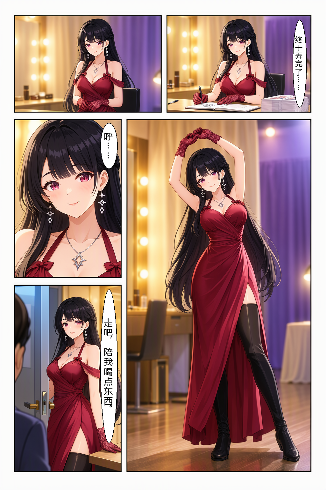
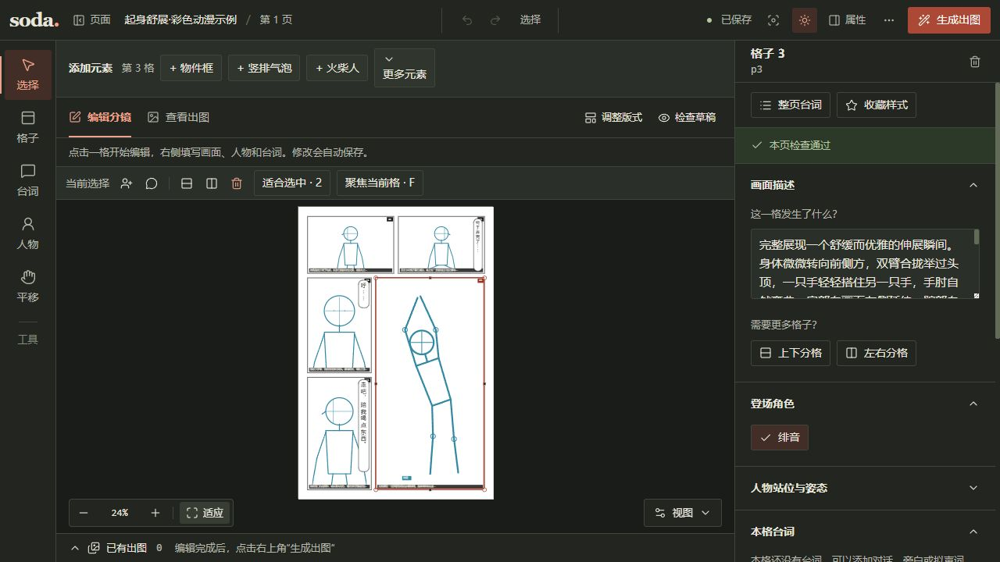

# 3. 从这张彩色漫画开始



这章用上面这张实测成图，走一遍插件的创作过程：和 AI 商量人物与镜头，看草稿，在网页里微调，确认后导出分镜包，最后交给 ComfyUI 节点出图和排字。

故事很短：

> 演出后台，绯音签完最后一张卡片，放下笔起身舒展。她放松地呼了口气，发现门边的同伴，笑着邀请对方去喝点东西。

绯音是 25 岁的原创成年女性。这页用黑长发、红紫眼、酒红礼服、蕾丝手套和黑长靴建立人物识别度，用右侧全身主格突出舒展姿态，配合暖金灯光与冷紫色帘幕。角色通过**文字提示词**描述，没有图片输入，也没有角色 LoRA。

## 独立路线：两句话、两格、从空目录开始

如果你要做自己的故事，可以先走下面这条最小主线，不需要复制 `examples/stretch-color`。示例故事只有两句话：

> 雨停后，晴雨牵着迷路的小猫来到旧书店。店主递给她一杯热茶，她笑着道谢。

以下命令都在你准备存放项目的**父目录**运行。`init two-sentence` 会在这里创建 `two-sentence` 子目录，不需要先创建或 `cd` 进入它；后面的命令也留在父目录运行，通过 `--project two-sentence` 或 `two-sentence/pages/...` 指向项目，避免再嵌套一层同名目录。`init`、角色卡和页面创建是自己或插件执行的命令；插件可以根据故事自动提出格子、人物和文字，**只有你确认后才写回**。`page new` 只建空页，不会自动增加格子。

| 步骤 | 插件可以自动做的部分 | 需要你自己确认或保存的部分 |
| --- | --- | --- |
| 初始化、建角色、建页 | 代填命令参数、生成中英文设定草案 | 目标目录、角色身份、颜色和画布设置 |
| 加格子、人物、文字 | 根据两句话提出拆格并写回 JSON | 格子数量、每格动作、台词原文，网页里等“已保存” |
| 校验、翻译、预览、编译、导出 | 按你确认的顺序串起命令 | 翻译英文内容、阅读顺序和最终草稿；这些命令不会自动调用 ComfyUI |

### 1. 初始化项目

```powershell
soda-storyboard init two-sentence --name "雨后的热茶" --width 1024 --height 1536 --direction rtl --json
```

预期输出（实际关键字段）：

```json
{"project":"two-sentence\\project.json","directories":["pages","characters","templates"]}
```

### 2. 写角色卡（命令行或编辑器）

命令行方式把服装的款式和颜色直接写进中英文外观，并用 `--outfit` 再保存两件服装：

```powershell
soda-storyboard character new --project two-sentence --id qingyu --name "晴雨" `
  --appearance-zh "黑色短发，琥珀色眼睛，青色雨衣，黄色围巾" `
  --appearance-en "short black hair, amber eyes, a cyan raincoat, a yellow scarf" `
  --role-en "the young traveler" --outfit "青色雨衣" --outfit "黄色围巾" --json
soda-storyboard character list --project two-sentence --json
```

预期看到 `characters/qingyu.json`，其中 `clothing` 有 `青色雨衣` 和 `黄色围巾`，`appearance.zh/en` 也有相同的颜色信息。插件可以先把中文设定补成英文，再由你确认命令；颜色和款式仍由你决定。

编辑器方式：先运行下面的命令，打开返回的 URL，切到“角色”页签，点“新建角色”，填写姓名、发型、发色、眼睛、服装款式与颜色，保存后再回到页面。选择已有角色可编辑，点“复制”可建立另一张角色卡。

```powershell
soda-storyboard edit two-sentence --detach --no-browser --json
```

本次实际返回 `url`、`port`、`pid` 三个字段；空项目也能先打开角色页。编辑器保存后会显示“已保存”。第 3 步建好 `tea-corner` 后，在页面列表选它继续编辑分镜。角色管理的字段说明见[角色卡](04-characters.md)和[网页编辑器](05-editor.md)。

### 3. 建立空白页面

```powershell
soda-storyboard page new --project two-sentence --id tea-corner --direction rtl `
  --width 1024 --height 1536 --style "Clean 2D anime comic, crisp ink outlines, soft cel shading" `
  --description "雨后的街角，晴雨牵着迷路的小猫来到旧书店，店主递给她一杯热茶。" `
  --dialogue-mode moss_text --text-direction vertical --color-mode color --json
```

预期输出包含 `pages/tea-corner.json`、`"panels": []` 和 `"texts": []`。这是正常的空页状态。

### 4. 加两格、人物和文字并保存

这一步可以让插件在你确认拆格后自动写回，也可以自己编辑刚生成的 JSON。命令行手动方式是打开 `two-sentence/pages/tea-corner.json`，保留文件已有的项目字段，把 `panels` 和 `texts` 设为下面内容，然后保存文件：

```json
{
  "panels": [
    {
      "id": "p1",
      "order": 1,
      "shape": {"type": "rect", "x": 48, "y": 48, "w": 928, "h": 680},
      "shot": "long",
      "angle": "eye",
      "character_ids": ["qingyu"],
      "description": "雨停后的街角，晴雨牵着一只迷路的小猫走到旧书店门口。青色雨衣和黄色围巾清楚可见，湿润的石板路反射着柔和天光。",
      "figures": [{"character_id": "qingyu", "pose": "walk", "position": "center", "facing": "right", "framing": "full"}]
    },
    {
      "id": "p2",
      "order": 2,
      "shape": {"type": "rect", "x": 48, "y": 752, "w": 928, "h": 736},
      "shot": "medium",
      "angle": "eye",
      "character_ids": ["qingyu"],
      "description": "旧书店柜台前，店主把一杯热茶递给晴雨。她双手接过杯子，肩膀放松，朝店主露出感谢的微笑；窗外的雨丝变成暖金色光点。",
      "figures": [{"character_id": "qingyu", "pose": "stand", "position": "center", "facing": "left", "framing": "waist"}]
    }
  ],
  "texts": [
    {"id": "t1", "text": "雨停了。", "kind": "narration", "panel_id": "p1", "speaker_id": null, "direction": "vertical", "bubble": "box", "bbox": {"type": "rect", "x": 830, "y": 82, "w": 90, "h": 180}},
    {"id": "t2", "text": "谢谢你，热茶真好喝。", "kind": "dialogue", "panel_id": "p2", "speaker_id": "qingyu", "direction": "vertical", "bubble": "speech", "bbox": {"type": "rect", "x": 820, "y": 820, "w": 90, "h": 520}}
  ]
}
```

在网页编辑器里则点“编辑分镜”，用“上/下分格”建立两个格子，在每格的“登场角色”里选晴雨，添加人物和台词，最后等顶部出现“已保存”。无论哪种方式，保存后都应能在页文件中数到 **2 格、2 个人物、2 条文字**。

### 5. 校验、翻译、预览、编译和导出

先校验结构；本次实跑返回 `"valid": true`，只提醒两格英文译文缺失：

```powershell
soda-storyboard validate two-sentence/pages/tea-corner.json --json
```

预期关键输出：

```json
{"valid":true,"exit_code":0,"warnings":[{"code":"caption_translation_missing","panel_id":"p1"},{"code":"caption_translation_missing","panel_id":"p2"}]}
```

`translate --todo` 由插件或你自己翻译场景、动作和道具；命令本身不会调用翻译服务：

```powershell
soda-storyboard translate two-sentence/pages/tea-corner.json --todo --json
```

把返回的 `source_hash` 原样带回译文文件。下面是本页实际使用的完整 `two-sentence/translations.json` 示例（角色外观和服装不放进译文）：

```json
{
  "translations": [
    {
      "panel_id": "p1",
      "source_hash": "fbf677e65bb223281a3c533e3ffa820a7ad61cb22f9b3e51e028f76f27de33e8",
      "text": "On a street corner after the rain, Qingyu leads a lost kitten to the old bookshop door. Wet paving stones reflect the soft daylight."
    },
    {
      "panel_id": "p2",
      "source_hash": "959d5314d49331affa379554aae3bfe3430efe75f3bd9cac46b09f41abe40f7c",
      "text": "At the old bookshop counter, the shopkeeper hands Qingyu a cup of hot tea. She accepts it with both hands, relaxes her shoulders and smiles gratefully; rain outside turns into warm golden points of light."
    }
  ]
}
```

确认哈希无误后写回：

```powershell
soda-storyboard translate two-sentence/pages/tea-corner.json --apply two-sentence/translations.json --json
```

本次返回 `{"applied":["p1","p2"],"rejected":[]}`。之后依次生成本地草稿、MOSS JSON 和单文件分镜包：

```powershell
soda-storyboard preview two-sentence/pages/tea-corner.json --output two-sentence/previews/tea-corner.png --json
soda-storyboard compile two-sentence/pages/tea-corner.json --output two-sentence/output/tea-corner.moss.json --slant-mode cut --json
soda-storyboard export-bundle two-sentence/pages/tea-corner.json --output two-sentence/exports/tea-corner.storyboard.json --json
```

实际关键输出分别是：`preview` 返回 `{"path":"two-sentence\\previews\\tea-corner.png","font":"auto"}`；`compile` 返回 MOSS `summary`/`items`（坐标格式为 `abs_centralized`/`yxyx`）；`export-bundle` 返回 `panel_count: 2`、`characters: ["qingyu"]`、`translation_status` 为两格 `fresh`，并写出上述三个相对路径。`preview`、`validate`、`compile` 和 `export-bundle` 都是本地操作，不会调用 ComfyUI；插件只会在你确认后替你串起这些命令。

## 1. 先复制完整示例

按 [安装章](02-installation.md)装好核心库和 Codex / Claude Code 插件。本例需要 **soda-storyboard 0.4.1 或更高版本**；如果要自己出图，还需要支持 MOSS 的 ComfyUI、节点包和模型。

下载本仓库后，把 [examples/stretch-color](../../examples/stretch-color) 整个目录复制到自己的故事目录。保留目录结构，项目设置、页面和角色卡才能一起读取。这里已经有一页完整分镜，直接读取即可。

| 文件 | 保存什么 |
| --- | --- |
| `project.json` | 默认画风、画布、阅读方向与 LoRA 策略 |
| `pages/stretch-color.json` | 五格画面、人物姿势与三句台词的位置 |
| `characters/hiyone.json` | 绯音的中英文外观与服装 |
| `translations.json` | 英文场景译文 |
| `exports/stretch-color.storyboard.json` | 可以直接上传到 ComfyUI 的分镜包 |
| `workflows/stretch-color.workflow.json` | 配套的 ComfyUI 工作流 |
| `output/character-prompt.txt` | 本次使用的角色英文描述 |

下面的命令从**本仓库根目录**运行，统一以 `examples/stretch-color` 为项目路径，页 id 为 `stretch-color`，角色 id 为 `hiyone`。在自己的副本练习时，把命令中的项目路径一起换成副本目录。

## 2. 把故事、画风和角色告诉插件

在加载了插件的聊天中，把自己的项目目录告诉 AI，再说：

> 用 soda-storyboard 读取这个项目。先给我看 stretch-color 页的故事、角色和草稿。这次保留彩色动漫画风、25 岁成年女主绯音和五格版式，重点是舒展身体时自然好看的全身姿态。台词保留中文，用程序后期排字。

如果从自己的新故事开始，可以这样提出需求：

> 女主结束工作后起身舒展，再笑着邀请同伴喝点东西。先给我 2～3 个拆格方案，再比较版式；想让人物的脸、长发和身材都得到表现，主画面保留完整全身。先讨论，选好以后再保存分镜。

插件会把故事拆成“先看到什么、在哪里停一下”。新故事可以比较几种拆格和版式，再选自己喜欢的；当前示例已经选定五格，不需要重新创建项目或空页。

角色外观也在这时说明白。绯音的固定设定是黑色及腰长发、整齐齐刘海与两侧姬式发束、红紫色眼睛、酒红色挂脖礼服与垂坠开衩裙摆、蕾丝手套、黑色过膝长靴和银色星形耳坠。插件把这些内容存进角色卡，逐格共用，详细写法见 [角色卡](04-characters.md)。

画风则存进项目或页面：本例是彩色二维动漫、细线、柔和赛璐珞与渐变上色，以暖金和冷紫灯光统一整页。人物外观、画风和每格动作分别写清楚，比只说“画好看一点”更容易继续修改。

## 3. 看五格怎样突出人物


这页从右上向左下阅读：上方先右后左，再看右侧竖向大格，最后读左侧上下两格。

| 顺序 | 内容 | 为什么这样安排 |
| --- | --- | --- |
| 1 | 签完卡片，放下笔：“终于弄完了……” | 交代后台环境和结束工作后的轻松心情 |
| 2 | 推开椅子起身，双手轻轻交握 | 为伸展动作留一个过渡 |
| 3 | 双臂举过头顶，身体自然伸长 | 用最大的竖格展示完整人物，给指尖与靴尖留余量 |
| 4 | 放松后的脸部特写：“呼……” | 从全身回到表情，表现舒展后的惬意 |
| 5 | 看向门边同伴：“走吧，陪我喝点东西。” | 用一个亲近的邀请结束这一页 |

青色人物是构图和姿势示意，绿色框是独立的文字对象。页面里用 `figures` 记录人物，用 `texts` 单独放台词与气泡位置，方便分别修改。

骨架帮助表达取景、朝向和动作，模型接收的仍是文字描述与位置框。握腕、视线和表情等细节也要写入画面描述。想调整主格，可以对插件说：

> 第三格身体侧弯少一点，双手自然搭在头顶上方，肩部放松。保持完整全身，头顶、指尖和靴尖都不要贴着格框。其他格子和台词保持原样。改完先给我看草稿。

<details>
<summary>手动校验并生成草稿</summary>

```powershell
soda-storyboard validate examples/stretch-color/pages/stretch-color.json --json
soda-storyboard preview examples/stretch-color/pages/stretch-color.json --output examples/stretch-color/output/stretch-color-sketch.png --json
```

草稿由本地工具绘制，不调用 ComfyUI，也不消耗生成次数。校验能发现几何与引用问题，人物最终画得怎样仍需要看成图。

</details>

## 4. 在网页编辑器里微调

对插件说“打开这一页的网页编辑器”，就可以自己拖动。



点格子改描述，点人物调姿势、朝向或关节，点文字改台词和框的位置。可以先只移动最后一格的气泡，观察它与人物脸部之间的距离；具体操作见 [网页编辑器](05-editor.md)。

网页与插件共用项目文件。拖完以后等界面显示保存完成，再告诉 AI：

> 我在网页里改过了，重新读取项目文件，再给我看更新草稿。

这样 AI 接着修改的就是刚保存的版本。没有改动的位置、人物和台词应继续保留。

```powershell
soda-storyboard edit examples/stretch-color --detach --page stretch-color --json
```

## 5. 确认整页，补译并导出

看到最后一版草稿、确认构图和台词以后，再告诉插件：

> 就按这版。检查英文译文，只补齐有变化的场景和动作，角色外观继续用角色卡，台词保留中文。编译并导出分镜包，我自己在 ComfyUI 运行。

随包示例已经有英文译文。页面没有变化时，待办应为空，可以直接编译和导出；改过画面描述时，插件会先检查哪些格子需要更新译文。

<details>
<summary>手动查看待办、写回译文并导出</summary>

```powershell
soda-storyboard translate examples/stretch-color/pages/stretch-color.json --todo --json
```

清单非空时，让插件 AI 依据最新 `source_hash`，只翻译场景、动作和道具，写入 `examples/stretch-color/translations.json`。人物外观由编译器从角色卡插入，台词保留原文。准备好译文后执行：

```powershell
soda-storyboard translate examples/stretch-color/pages/stretch-color.json --apply examples/stretch-color/translations.json --json
```

如果哈希不匹配，重新查看待办并更新对应译文。没有待办时可以跳过写回。

```powershell
soda-storyboard validate examples/stretch-color/pages/stretch-color.json --json
soda-storyboard compile examples/stretch-color/pages/stretch-color.json --output examples/stretch-color/output/stretch-color.moss.json --json
soda-storyboard export-bundle examples/stretch-color/pages/stretch-color.json --json
```

</details>

编译得到 MOSS 使用的布局 JSON，导出得到 `examples/stretch-color/exports/stretch-color.storyboard.json`。分镜包把当前页、出场角色卡、项目设置与草稿缩略图装进一个文件，方便交给节点。导出本身只整理本地文件，不会提交生成任务。

## 6. 交给 ComfyUI，自己点击运行

在 ComfyUI 按 `Ctrl+O` 打开 `examples/stretch-color/workflows/stretch-color.workflow.json`。从 GitHub 单独下载时，用 **Raw / Download raw file** 保存 JSON 原文。

然后把刚导出的 `exports/stretch-color.storyboard.json` 拖到“导入分镜”节点预览区，或点击“上传”选择文件。配套工作流没有携带你电脑上的上传副本，所以打开工作流后仍需要上传分镜包。


核对 **1024×1536、5 格、3 句台词、英文译文新鲜、本页不使用 LoRA**。在“逐格”里看故事，在“提示词”里看实际输出的 MOSS JSON，点“查看”打开大窗口。


在 `UNETLoader`、`CLIPLoader`、`VAELoader` 中重新选本机模型。此次使用 MOSS-Image SFT INT8、`qwen3.5_9b_w4a8_gptq.safetensors` 和 `flux2-vae.safetensors`，文本编码器类型选 **`moss_image`**。

配套工作流保存了本次实测参数：1024×1536、shift 5、50 步、CFG 3、`euler` / `simple`、SLG 单层 `22`、固定种子 `20261022`。确认批次数量为 **1** 后，手动点击“运行”。这套设置属于随包节点工作流，不等同于 CLI 的默认生成预设。

本页全为矩形，解码后直接接“排字” `SodaLetterPage`，再由 `SaveImage` 保存。工作流保留模型画出的格框，没有接 `SodaCutQuads` 重画边框。三句中文台词由程序绘制气泡和文字。

结果在最后的保存节点、任务历史和 ComfyUI 的 `output` 目录查看。详细连线、字体与节点编辑方法见 [ComfyUI 用法](08-comfyui.md)和[节点侧完整教程](https://github.com/cOkieeman/ComfyUI-Soda-Storyboard/blob/main/docs/tutorial-stretch-color.md)。

## 7. 看结果，再提出具体修改


先看主格人物是否完整、手部和双臂是否自然，再看各格发型、脸型和服装是否一致，最后读三句台词，检查气泡有没有挡脸。

本次成图的第 2 格仍偏坐姿，和“推开椅子站起”的描述不完全一致。下一轮可以明确提出：

第一格成图里人物仍握着笔，和“放下笔”的描述有出入，也要在复盘时单独记下。

> 第二格镜头稍微拉远，让椅面和站起后的腰胯都进入画面；臀部已经离开座面，双脚着地，表现起身后的重心。保留其他格子、角色外观和台词，先改草稿给我看。

插件修改后，重新确认、补译、导出，再上传到节点。ComfyUI 中的上传文件是副本，原项目保存后的变化需要通过新分镜包带过去。

本次在我们的机器上完整执行约 **102.5 秒**，仅供参考。硬件、模型版本与运行环境会影响耗时和画面，相同种子也不保证逐像素一致。

用完网页编辑器后，可以让插件停止后台服务：

```powershell
soda-storyboard edit examples/stretch-color --stop --json
```

[下一章：角色卡怎么写](04-characters.md) · [返回目录](README.md)
