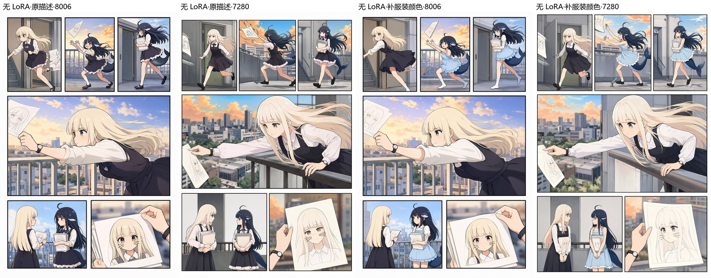

# 4. 角色卡怎么写

同一个角色可能在一页里出现好几次，发型和衣服最好有一份固定的说明。角色卡做的就是这件事：各格共用人物的外观与标志物，后来改了设定，也只需要更新这一份，后续编译就会读到新描述。

## 先看本例的绯音角色卡

「起身舒展」的[角色卡](../../examples/stretch-color/characters/hiyone.json)固定了绯音的中英文外观：25 岁成年女性、黑色长发和齐刘海、红紫色眼睛、酒红色露肩挂脖礼服与蕾丝手套、黑色过膝长靴，以及银色星形耳坠。完整英文描述见[角色提示词](../../examples/stretch-color/output/character-prompt.txt)。

五格共用这份外观，各格的坐姿、抬臂、视线和表情另写在页面里。想换自己的角色，先修改角色卡的外观与服装，再看最终提示词是否读到了新设定。本例没有角色 LoRA，也没有图片输入。

```powershell
soda-storyboard character list --project examples/stretch-color --json
```

命令从仓库根目录运行。下面再用一个独立的双人案例说明，人物同框时怎样区分服装。

## 写出能区分两个人的细节

两个人同框，模型需要知道哪些特征属于谁。角色卡至少要写出发型与发色、衣服款式与颜色，以及显著的标志物。比如下面这两份描述，就比“两位穿裙子的女孩”容易区分：

| 角色 | 外观 |
| --- | --- |
| Sylvia | 浅金色长直发、齐刘海；白色长袖衬衫配深色背心裙；戴手表 |
| 鲸鱼娘 | 深色长发、呆毛、鲸鱼头饰和尾巴；浅蓝色荷叶边吊带连衣裙 |

如果只写“裙子”或“荷叶边”，模型仍可能借用另一人的衣服。颜色也值得写进去，尤其是两个人都穿连衣裙的时候。把中文描述交给 AI，可以请它顺手补上英文，两边沿用同一套设定。



这组 draft 档实测中，鲸鱼娘曾被画成 Sylvia 的衣服。补上“浅蓝色荷叶边吊带连衣裙”后，图中的两套服装区分得更清楚了。

可以对插件说：

> 鲸鱼娘穿浅蓝色荷叶边吊带连衣裙，别和 Sylvia 的白衬衫、深色背心裙混在一起。把两人的角色卡都写清楚，先不加 LoRA。

<details>
<summary>用命令行新建和修改角色卡</summary>

新建角色：

```powershell
soda-storyboard character new --project my-project --id whale --name "鲸鱼娘" --appearance-zh "深色长发，呆毛，鲸鱼头饰和尾巴，浅蓝色荷叶边吊带连衣裙" --appearance-en "long dark hair, an ahoge, a whale hair ornament and tail, a light-blue ruffled camisole dress" --json
```

已有角色可以用 `set` 更新：

```powershell
soda-storyboard character set whale --project my-project --appearance-zh "深色长发，呆毛，鲸鱼头饰和尾巴，浅蓝色荷叶边吊带连衣裙" --appearance-en "long dark hair, an ahoge, a whale hair ornament and tail, a light-blue ruffled camisole dress" --json
soda-storyboard character list --project my-project --json
```

`set` 只修改命令里给出的字段。上面的例子把服装写进了中英文外观，没有单独传服装列表。也可以用 `--outfit`，不过它会原样加入 caption；如果希望提示词保持英文，这一项也要写英文。

`--outfit`、`--trigger`、`--reference` 都可以重复传入多个值。传入某一项列表时，会替换它原有的整份列表；没传的列表保留。`--reference` 记录的是参考图路径，不会自动把图片接入参考图控制。

</details>

## LoRA 可选，每页只用一个

没有 LoRA 也可以做完整的一页。需要辅助某个角色的外观时，再往角色卡里补模型文件名和强度；新建时省略强度，默认是 0.8。模型文件需要已经放在 ComfyUI 中，角色卡只记录使用哪一个。

整页生成一次最多加载一个人物 LoRA，其他角色靠各自的外观和衣服描述出图。网页编辑器的页面属性里有“本页 LoRA 角色”，可以选自动、不使用，或者某个带 LoRA 的角色，后期计划也不会为配角安排逐个替换。

0.4.1 的项目设置有两种策略：

```json
{"lora_policy": "single"}
```

策略写在项目的 `project.json` 中。默认的 `single` 让整页最多加载一个角色 LoRA；设为 `none` 时，自动选择会让整页按角色描述出图。也可以在页面指定使用哪个角色：

```json
{"lora_character": "sylvia"}
```

手动改文件时，把这两段字段分别合并进原来的项目和页文件。页面的值填 `"none"` 会关闭本页 LoRA，省略则自动选择。

自动选择算的是每个角色出场格子的累计面积，从带 LoRA 的角色里选权重最高的一个，权重相同再按 id 排序。一个角色虽然只出现一次，但占了一张大格，也可能比多次出现在小格里的人更优先。

上面的项目和页面设置管的是自动选择。如果生成时使用 `gen page --lora <角色id>`，就会覆盖项目或页面的“不使用”，不过一次仍只加载一个。高级 swap 和生成式 cutout 也能按各自的路径从角色卡读取 LoRA，但不推荐用它们反复换角色。

## 看到提醒后怎么改

`validate` 和编辑器检查器都会提醒服装描述里可能缺少的内容。看到提醒时，可以回到角色卡检查款式和颜色是否齐全。两个人穿得很像，也可能本来就是你的设计，程序只把它提出来，不会替你改设定。

多人同格时，编译器会分别写出每个人的衣服，再补上各人保持自己服装的描述。这些内容都要以角色卡为依据，角色卡里没写的款式和颜色，编译器也补不出来。

[下一章：网页编辑器](05-editor.md) · [返回目录](README.md)
