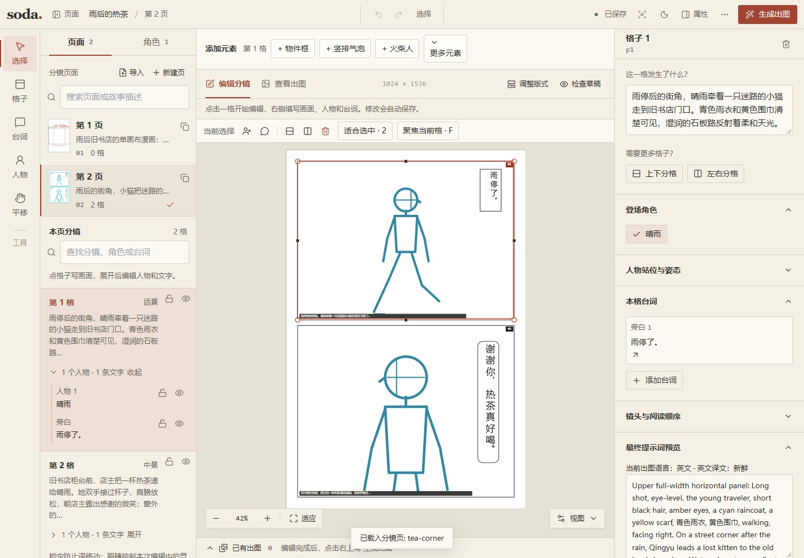
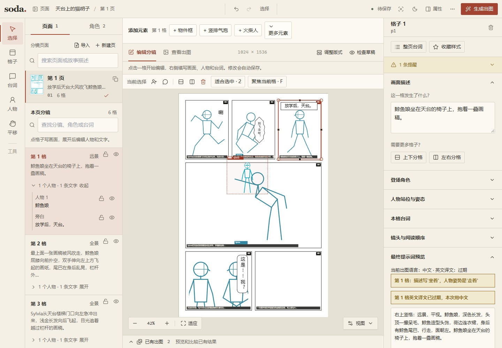

# 5. 网页编辑器

当你已经大致想好这一页，挪个人物、拉大一个文字框，往往直接在画布上拖更方便。编辑器保存的就是故事项目里的文件，改完以后，AI 和命令行还能接着使用。

让 AI 打开当前页，或者自己运行：

```powershell
soda-storyboard edit examples/stretch-color --detach --page stretch-color --json
```

`--detach` 会让服务留在后台，终端可以继续使用。同一项目再次打开时会复用已有服务；默认端口 8780 被占用则会换一个空闲端口，所以浏览器地址以返回的 `url` 为准。加上 `--no-browser` 可以只取得地址，稍后再打开。


图中选中的是「起身舒展」第三格，左侧页面面板已收起，中央查看完整分镜，右侧填写这一格的描述和人物。命令从仓库根目录运行；自己的故事项目需要替换目录和页 id。

## 先选中，再修改

页面和角色在左侧切换。画布上的格子、人物、文字都可以点选，右侧检查器会跟着显示对应的设置：选格子可以改画面描述、景别和阅读次序，选人物可以改角色、位置和朝向，选文字可以改原文、说话人、方向与气泡。

想新增内容，用工具条里的格子、人物或台词工具，也可以从“添加元素”进入。已有元素可以拖动、缩放或删除。拉格子时留意格间的空隙与越界提醒；格子编号是阅读次序，默认日漫从右上往左，再读下一行。

文字内容和框的位置可以分别改。竖排留竖长框，横排则需要较宽的框；长句会换列或换行。气泡看起来摆得下以后，也别忘了读一遍断句和标点。

需要出图时，从出图入口生成候选；已有候选可以在审阅界面比较、选用，后期任务的状态和报错也在相应入口查看。

## 人物姿势和关节

从一个接近的预设开始会比较省事，比如站、走、跑、坐、蹲、挥手、指向、举手、抱手或托腮，再拖关节调整。人物的大小、朝向、镜像和是否允许出框，也都可以一起设置。

这里摆好的骨架会被近似转成动作文字，人物框则给模型提供位置。模型收到的并不是 ControlNet 那样的精确姿势图，所以复杂手势最好也写进画面描述里，例如哪只手抬起、手里拿着什么，成图后再看是否画到了。

## 在编辑器里管理角色

左侧切到“角色”，可以新建角色、编辑已有资料或创建副本。没有页面的项目也能先建角色库。角色资料由整个项目共用，修改后需要点“保存角色”；页面上的人物位置和姿势仍按页面保存。切换角色会保留本次打开的草稿，关闭或刷新浏览器前请先保存。

新角色可以分别填写发型、发色、眼睛、服装款式与颜色、标志物，编辑器会合成中文外观。英文外观可以手填，也可以暂时留空，再交给插件 AI 翻译后填回。旧卡按原有文本展示，不会自动猜测和替换外观。服装缺失、缺颜色和同页服装相似会显示提醒，仍允许保存待完善的角色；头发或眼睛的颜色不能代替服装颜色。

LoRA 是可选项。每页最多使用一个角色 LoRA，其余人物依靠角色外观描述保持一致，所以配置了 LoRA 也应填写外观。人物色只用于分镜草稿识别，与衣服和头发的实际颜色无关。复制角色时默认不复制 LoRA 和触发词，可以按需选择。

保存会检查打开草稿时的角色版本。如果文件已被 AI、命令行或另一个窗口改过，编辑器会保留本地草稿并提示冲突，请核对服务器版本后再处理。外观保存会刷新校验和最终提示词，不会使场景译文过期；已有图片可能仍使用旧设定，需要重新生成。改名、更改 ID 和删除留待后续阶段，当前界面不提供这些操作。

## 最终提示词和冲突提醒



图：浅色主题、1440 像素宽的编辑器在编译完成后显示实际 caption（状态为“英文译文：新鲜”，不是“正在编译当前修改…”）。其中人物外观来自 `characters/qingyu.json` 的中英文外观和服装字段，动作来自这一格的 `figures.pose/facing/framing`，场景来自页面描述经过 `translate --todo/--apply` 写回的英文译文。

写在画面描述里的动作，和人物预设有时会打架。比如你把描述改成了“坐着”，人物却还在走路，检查器就可能提醒。这时看一下最终提示词，决定是改动作还是改文字，两边说清同一件事就好。



描述写“坐着”，人物仍是“走着”时的提醒。程序只能识别部分冲突，其他地方也需要自己读一遍。

通常用自动提示词就够了。如果要自己写整段 caption，可以开启手动覆盖，同时写全方位、人物和动作。旧文件里的 `caption_en` 也只有在开启覆盖或旧版兼容设置后才会优先使用。

## 单画布页

有些 MOSS JSON 本来就是一张海报或一幅完整画面，导入后会成为没有格子的“单画布”页。物件框、人物框和文字框直接放在画布上，同样可以移动、缩放和改描述。

外来人物框记录的是人物区域，还没有绑定角色卡或可拖动的关节。导入时的尺寸和理解报告怎么核对，见 [导入别人的分镜](09-import.md)。

## 快捷键和主题

画布操作常用的快捷键如下。输入文字或使用输入法组词时，画布快捷键会避让；macOS 把 Ctrl 换成 Command。

| 按键 | 操作 |
| --- | --- |
| Ctrl+S | 立即保存 |
| Ctrl+Z / Ctrl+Shift+Z 或 Ctrl+Y | 撤销 / 重做 |
| Ctrl+C / Ctrl+V / Ctrl+D | 复制 / 粘贴 / 复制选中元素 |
| 方向键 / Shift+方向键 | 微调位置 / 较大步移动 |
| Delete 或 Backspace | 删除选中元素 |
| Esc | 取消当前选择或操作 |
| 1 / 2 | 适应整页 / 适应选中内容 |
| F | 聚焦当前格子 |
| Ctrl+K / ? | 打开命令菜单 / 快捷键帮助 |

界面可以切换浅色或深色主题。开头的彩色示例截图使用深色界面，下面的提示词与冲突示意图来自其他页面的浅色界面；切主题不会改变漫画的颜色设置。

## 保存、同步和冲突

顶部的“与 AI 同步中”表示浏览器和本地服务连着，能收到页文件在外部发生的变化；断线后会尝试重连。它显示的是连接状态，AI 仍需要自己读文件，才能知道你改了什么。

在网页里改完，等保存完成，再让 AI 重新读取页 JSON。如果网页还没保存，外部文件又变了，编辑器会提示冲突。选好要保留的版本并保存后，双方再继续修改，可以避免旧内容覆盖回来。

用完以后可以关闭后台服务：

```powershell
soda-storyboard edit examples/stretch-color --stop --json
```

停止前会核对项目和运行实例。若提示状态不匹配，检查是否选错了项目；旧状态里的 PID 可能已经属于别的进程，不能直接按它结束程序。

[下一章：提示词是怎么来的](06-prompts.md) · [返回目录](README.md)
