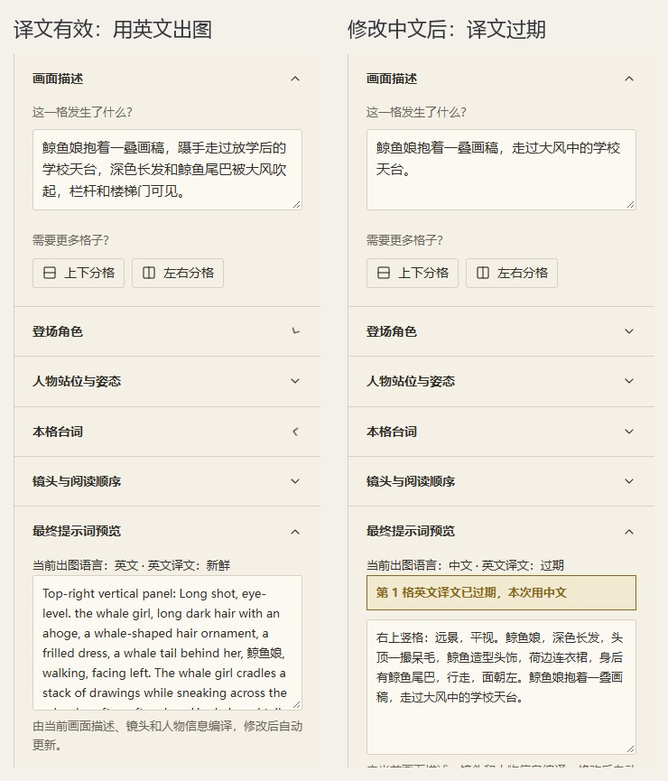

# 6. 提示词是怎么来的

打开最终提示词时，你会看到一整段描述，里面不只有自己写的中文场景，还有人物外观、朝向和“右上方竖格”这样的位置信息。它们来自分镜的不同部分，由程序在编译时拼起来。

默认用英文描述画面，台词保留中文原文。日常修改仍然用中文就行，下面解释这些内容怎样变成 MOSS 布局 JSON。



同一格在修改中文场景前后的译文状态：原来的英文过期后，本次编译回退中文。

## 一格会拆成哪些内容

MOSS JSON 中，`summary` 说明整页的画风、阅读方向和留白要求。每格则有一个 `object` 条目，把几何位置、镜头、人物和场景放在一起。

这个条目的 caption 会先说格子在什么位置、是什么形状，再写景别和角度，接着是人名、角色卡外观与姿势，最后接上场景译文。你移动格子，顶部、左侧、横格或斜格这些方位说法就会重新计算。

人物另外有 `character` 条目，框的范围来自草稿骨架，帮助模型安排人物位置；`mode: moss` 的跨格人物也编译成这种条目。对白、旁白、拟声词和标题则使用 `text` 条目，原文单独放在 `text` 字段中。

台词模式决定文字在哪一步画。选 `moss_text` 时，原文和文字框会送给模型；选 `lettering` 时，编译会把台词留给后期排字，要求模型先画没有气泡的画面。

## 翻译只处理场景、动作和道具

```powershell
soda-storyboard translate my-project/pages/rooftop.json --todo --json
```

这条命令会列出待翻译的中文。插件 AI 负责翻译其中 `source_zh` 的场景、动作和道具，并按项目术语表选词。衣服和外观已经在角色卡里，镜头、方位和自动姿势也都有来源，译文里无需再写一遍。

AI 写回的文件采用下面的格式。`source_hash` 是这次中文内容的校验值，要从当前待办中原样复制：

```json
{
  "translations": [
    {
      "panel_id": "p1",
      "source_hash": "复制当前 todo 中这一格的 source_hash",
      "text": "The whale girl cradles a stack of drawings and tries to slip away across the school rooftop after classes. Strong wind lifts her hair and tail. The railing and stairwell door are visible."
    }
  ]
}
```

示例中的哈希只是占位文字。换成待办给出的实际值、保存为 `my-project/translations.json` 后，用下面的命令写回：

```powershell
soda-storyboard translate my-project/pages/rooftop.json --apply my-project/translations.json --json
```

因此，`--todo` 和 `--apply` 之间还有 AI 写译文这一步。核心库和网页本身不调用翻译服务，只负责列待办、校验和保存。

## “新鲜”“过期”“需要重新翻译”

| 状态 | 含义 | 下一步 |
| --- | --- | --- |
| 新鲜 | 缓存对应当前中文来源 | 可继续编译 |
| 过期 | 场景、动作或道具的中文变了 | 重跑待办、翻译、写回 |
| 缺失 | 这一格还没有缓存 | 让 AI 补译 |
| 需要重新翻译 / legacy | 旧缓存没有新版场景译文标记 | 根据新的 `source_zh` 重新翻，不沿用含外观的旧整句 |

译文是否过期，看的是待翻译中文有没有变。只是挪了格子或改了角色卡上的衣服，场景译文仍然有效；编译会取最新的位置和外观。`--apply` 还会自动补上 `format: scene-v1` 标记，用来和旧整句缓存区分。

缺失或过期的格子会提醒，并退回整理后的中文，所以文件能导出，并不表示每一格都已用上英文。写回遇到哈希不符，通常说明中文在翻译期间又变了，重新列待办、按新内容翻译即可。

像“猫胡子”这样的词，如果希望每次译法一致，可以在项目 `project.json` 里加术语表：

```json
{"glossary": {"猫胡子": "cat whiskers"}}
```

把这段字段合并进原文件即可。如果本来就想用中文出图，设置 `caption_language: zh` 后沿用中文，不需要为了清空英文待办而换语言。

## 看一个真实编译结果

天台页的第一格编译后，画面条目如下。这里只摘出一个 object，完整文件还包含 summary、人物和其他格子：

```json
{
  "label": "object",
  "caption": "Top-right vertical panel: Long shot, eye-level. the whale girl, long dark hair, an ahoge, a whale hair ornament, a light blue frilled sundress, a whale tail behind her, walking, facing left. The whale girl cradles a stack of drawings and tries to slip away across the school rooftop after classes. Strong wind lifts her hair and tail. The railing and stairwell door are visible.",
  "bbox": [-722, 171, -317, 466]
}
```

对照这段就能看出：衣服和外观来自角色卡，`walking, facing left` 来自人物姿势，后面才是 AI 补译的天台、画稿和风。译文仍然要交代谁在做什么，只是不必再描述一遍长相。

编译命令：

```powershell
soda-storyboard compile my-project/pages/rooftop.json --output my-project/output/rooftop.moss.json --slant-mode cut --json
```

坐标也在编译时转换：源页用左上角像素 `x/y/w/h`，MOSS 用中心原点的整数 `[y_min, x_min, y_max, x_max]`，并声明 `abs_centralized` 和 `yxyx`。平时在编辑器里摆位置，无需手算。

有斜切格时，默认 `cut` 还会产生 `rooftop.moss.cut.json`，供后期按真实四边形裁剪；给模型的是 `rooftop.moss.json`。`--with-ids` 用于调试，会增加辅助字段和 map，日常交付无需加。

[下一章：出图和后期](07-generation.md) · [返回目录](README.md)
