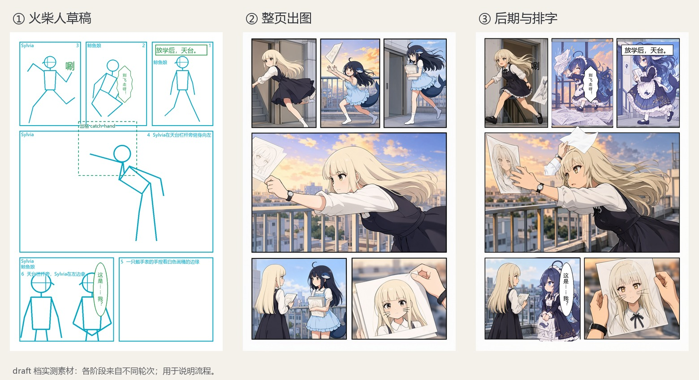
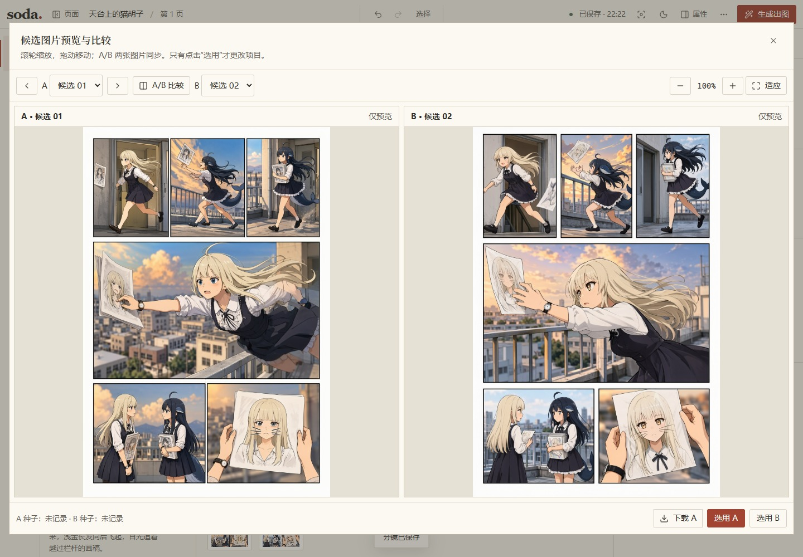

# 7. 出图和后期

整页生成可以从 draft 开始，等构图合适后，再决定使用 final 重新生成，还是只修有问题的局部。提高步数也会改变画面，因此 final 的结果可能与草稿不同。



图：从本地草稿、draft 档整页出图，到后期排字后的实测成品。挑选底图时，动作和人物关系通常比小细节更值得优先看。

## 质量档和候选

| 预设 | 步数 | 采样器 / 调度器 | CFG | SLG | 1024×1536 实测参考 |
| --- | --- | --- | --- | --- | --- |
| draft | 25 | er_sde / simple | 2.5 | 无 | 约 40 秒 / 张 |
| final | 50 | euler / simple | 3 | single_layers=22 | 约 80 秒 / 张 |

表中耗时来自本机实测，实际速度还受硬件和队列影响。ComfyUI 配置和模型列表确认后，就可以告诉 AI 这次要生成几张候选。四张候选大约需要四次采样；如果命令超时，服务器上的任务可能还在运行，重试前需要查看队列。

```powershell
soda-storyboard gen page rooftop --project my-project --seeds 4 --preset draft --lora auto --json
```

`--seeds 4` 会生成四个随机种子，对应四张候选。需要使用指定的种子比较结果时，可以重复传入 `--seed`：

```powershell
soda-storyboard gen page rooftop --project my-project --seed 12345 --seed 67890 --preset draft --lora auto --json
```

这里给了两个种子，就只生成两张，不会按默认四张补足随机候选。比较同一种子的结果时，模型、提示词、尺寸和其他参数也应保持一致；跨环境运行仍可能有像素差异。

`gen page` 会自动编译，返回的 `meta.candidate_sheet` 是候选拼图，每张候选都记录了实际种子和路径。`--lora auto` 按本页策略使用 LoRA；传入 `none` 表示这次不用 LoRA，传入角色 id 则明确选择该角色。



图：draft 档实测候选。除了脸部，手里的画稿、人物朝向和两个人的衣服也会影响这张图能否作为底图。

## 选底图，看后期计划

```powershell
soda-storyboard pick rooftop render.png --project my-project --json
soda-storyboard plan rooftop --project my-project --json
```

`render.png` 需要换成已登记候选的实际路径或唯一文件名，直接复制进来的图片不会自动登记为候选。选好后，`plan` 会列出斜切、出框图层和排字等后续步骤。在 0.4.1 中，即使配角有自己的 LoRA，也不会因此安排换人。

如果重新选择底图，旧的格子选择和派生成品就会失效。需要对新底图重新完成后期，才能导出相应的拼页图或排字图。

## 修一格或一小块

整页里只有某一格需要调整时，可以拆出格子，再重画有问题的那一格：

```powershell
soda-storyboard split rooftop --project my-project --json
soda-storyboard redraw rooftop p3 --project my-project --mode detail --denoise 0.45 --seed 12345 --json
```

`detail` 适合修细节，默认降噪约 0.45。重画结果仍是候选，需要看过后用 `pick-panel` 选中。下面的占位图片名应换成这一格实际返回的路径：

```powershell
soda-storyboard pick-panel rooftop p3 panel-render.png --project my-project --json
```

如果只想修改人物附近的区域，可以先离线查看遮罩范围：

```powershell
soda-storyboard inpaint rooftop p3 --project my-project --character sylvia --mask-only --json
```

遮罩合适后，去掉 `--mask-only` 就会提交生成。范围偏小可以用 `--margin` 扩大，边缘用 `--feather` 调整羽化；如果人物框本身偏了，需要回到人物几何里修改。`inpaint` 默认降噪为 0.85，是否降低取决于希望改动画面的幅度，整格 detail 的数值不一定适用。

整格重画和局部重绘都会把格子放大到长边 1024、宽高对齐 16 的工作尺寸，生成后再缩回原格。小格因此有了更多采样空间，手、脸和文字的结果仍需要检查。`redraw --mode swap` 保留为单人格的手动高级选项；用它逐个替换 LoRA 角色可能造成画风和比例不一致，因此不推荐这样使用。

## 出框人物和物件

需要强调动作或人物时，可以让它们越过格子边界。大部分第一页用普通分格就够了，出框元素需要时再加。

| 图层设置 | 怎么画 | 后续操作 |
| --- | --- | --- |
| `mode: moss` | 跨格人物直接进入整页 MOSS 提示词 | 不再单独 cutout |
| `mode: layer` | 作为透明图层后期叠加 | 生成并抠图，或导入已有透明 PNG |

`cutout_type` 中，`whole` 表示全身人物，`partial` 表示人物局部，`object` 表示物件。默认的 `auto` 会尝试判断，无法判断时按物件处理。比如手部特写就适合用 `partial`，描述里也要写清可见范围，以免生成全身人物。

如果已经有透明 PNG，可以直接离线导入。假设图层 id 为 `hero`：

```powershell
soda-storyboard cutout rooftop hero --project my-project --png refs/hero-transparent.png --json
```

`--png` 的相对路径按项目目录解析，例子中对应 `my-project/refs/hero-transparent.png`。省略 `--png` 则会调用模型生成，并需要可用的抠图节点，提交前应确认生成数量与范围。如果提示缺少 BiRefNetRMBG / RMBG / rembg，可以按错误补齐节点，或使用现成的透明 PNG。`redraw`、`inpaint` 和生成式 `cutout` 都支持 `--seed`。

## 拼页、排字、导出

```powershell
soda-storyboard compose rooftop --project my-project --cut-inset 12 --border-width 3 --json
soda-storyboard letter rooftop --project my-project --json
soda-storyboard export rooftop --project my-project --format png --json
soda-storyboard export my-project --format pdf --json
```

`compose` 会使用已选格子，按四边形裁剪斜格、重画边框，再叠加图层。接着，`letter` 为 `lettering` 模式的文字排字，也支持把单条文字设为程序排字。如果一页使用 `moss_text`，只想补排其中几条，可以重复传入 `--text <文字id>` 指定。

如果找不到字体，可以用 `letter --font <字体文件>` 指定。排字完成后，长句的换行、竖排标点和文字遮挡都需要看一遍。导出会使用当前有效结果中阶段最高的一张：有排字图就用排字图，其次是拼页图，最后是选定底图。导出整项目 PDF 时，各页会按页序合并。

[下一章：在 ComfyUI 里用](08-comfyui.md) · [返回目录](README.md)
