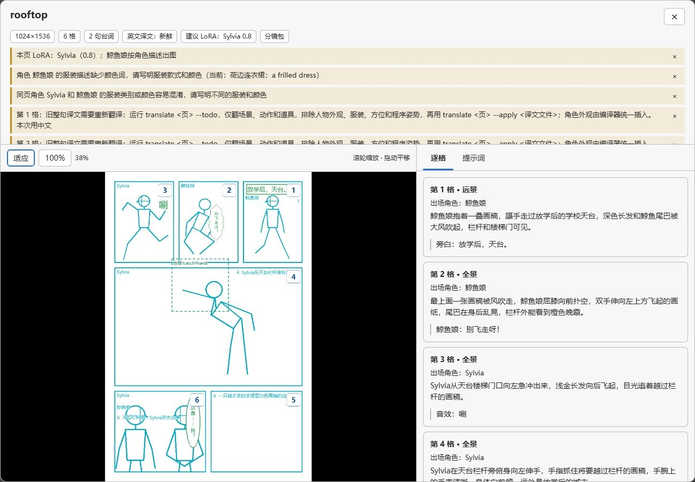
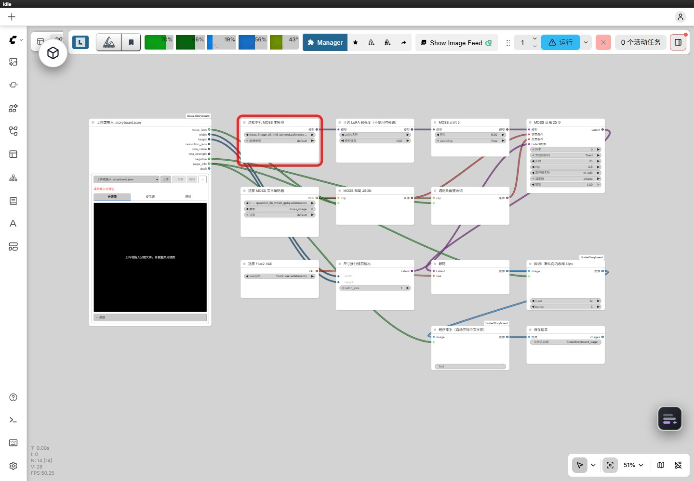

# 8. 在 ComfyUI 里用

分镜定下来后，就可以把这一页交给 ComfyUI 了。建议导出分镜包：当前页、出场角色卡和项目设置都在里面，传一个文件就够了，也能把人物外观一起带过去。

## 1. 从插件导出

确认整页内容、补齐译文后，对插件说：

> 把 rooftop 页导出成分镜包，我要拖进 ComfyUI。

```powershell
soda-storyboard export-bundle my-project/pages/rooftop.json --json
```

默认导出到 `my-project/exports/rooftop.storyboard.json`。这里导出的只是分镜资料，LoRA、参考图和模型文件要另外准备，采样也留到 ComfyUI 里运行。加 `--no-sketch` 可以省略包里的草稿缩略图。

## 2. 导入并看提醒

装好节点包和核心 wheel 后，在 ComfyUI 打开节点仓库的整页示例。安装命令在 [安装章](02-installation.md)。把分镜包拖到示例中“导入分镜”的预览区，或点“上传”，就能沿用示例接好的线；拖到空白画布则会新建一个导入节点。


图：导入节点的预览组件，使用 draft 档实测分镜包离线查看。

导入支持三种文件：

| 文件 | 从哪里取得 | 注意什么 |
| --- | --- | --- |
| 分镜包 `*.storyboard.json` | 插件或 CLI `export-bundle` | 适合完整交接，优先用它 |
| 裸分镜单 `pages/<页id>.json` | 故事项目中的页文件 | 单页没有角色卡时会提醒，外观和 LoRA 信息可能缺失 |
| MOSS JSON | 其他 AI、编译输出或现有工作流 | 主要是提示词和位置框，可能没有漫画格 |

文件导入后，顶部会列出尺寸、格数（或“单画布”）、台词数、译文状态和建议 LoRA。黄色提醒会说明哪些地方需要处理，例如缺角色卡或译文过期。旧文件的译文标签有时与详细提醒不一致；如果提醒写着“需要重新翻译”，就回插件按待办重译。

## 3. 看草稿、提示词和大窗口

想确认人物和文字放得对不对，可以看“分镜图”；想知道实际交给 MOSS 的内容，切到“提示词”，那里是完整的输出 JSON。“逐格”把每格的描述、角色和台词放在一起，方便对照。没有格子的 MOSS JSON 会改为显示“条目”，按文字、人物和物件分组。

节点里看不清时，点“查看”或分镜图打开大窗口。



图：大窗口查看器的离线截图，内容来自 draft 档实测分镜包。

大窗口里可以滚轮缩放、拖动平移。“适应”显示整页，“100%”恢复原尺寸；鼠标停在右侧某一格上，左边会高亮对应区域。提示词可以复制全文，“格式化”只调整显示方式，输出内容保持原样。

台词由谁来画、斜切格怎么处理、是否自动加入触发词，都可以在“高级”里调整。导入 MOSS JSON 时，这里还可以手填宽高，覆盖自动推断的尺寸。各选项见 [节点 README](https://github.com/cOkieeman/ComfyUI-Soda-Storyboard#使用方法)。

## 4. 选示例工作流

| 工作流 | 适用场景 | 开始前检查 |
| --- | --- | --- |
| [minimal_page.json](https://github.com/cOkieeman/ComfyUI-Soda-Storyboard/blob/main/example_workflows/minimal_page.json) | 第一次出整页，或重新生成整页 | 分镜、模型、宽高、台词模式 |
| [panel_redraw.json](https://github.com/cOkieeman/ComfyUI-Soda-Storyboard/blob/main/example_workflows/panel_redraw.json) | 已有整页，只修某一格 | 原图、格子选择，默认降噪 0.45 |
| [character_swap.json](https://github.com/cOkieeman/ComfyUI-Soda-Storyboard/blob/main/example_workflows/character_swap.json) | 按人物区域做局部重绘 | 切格和遮罩选同一格，默认降噪 0.85 |

第一次出图用 `minimal_page.json`。有了整页图之后，修一格用 `panel_redraw.json`，只动人物所在区域则用 `character_swap.json`。第三个文件沿用了旧名称，日常也可以用来修局部细节，逐个替换角色 LoRA 并不是默认用法。



minimal_page 在真实 ComfyUI 中的连线。为便于看全图，临时整理了节点位置，截图时尚未导入分镜包或运行采样。

三个示例用到的都是本包和 ComfyUI 核心节点，ComfyUI 版本需要支持 `moss_image` 和 `EmptyFlux2LatentImage`。示例 JSON 中保留了完整连线和参数，可以直接打开查看。

## 5. 在原生 Loader 里选模型和 LoRA

示例只保存了模型的基本文件名。打开后，在 `UNETLoader`、`CLIPLoader`、`VAELoader` 中重新选择本机文件，这样模型放在子目录里也能选对。文本编码器类型选 `moss_image`。

角色 LoRA 也在工作流里选：需要时，在原生 `LoraLoaderModelOnly` 中选择文件和强度，一次用一个；不用时旁路这个节点。“导入分镜”会列出角色卡里的 LoRA 建议，默认示例仍由你手选实际加载的文件。草稿、提示词和模型都确认好，就可以点击 ComfyUI 运行了。

如果已有自己的工作流，将 `moss_json` 接到 MOSS JSON 文本输入，`width` / `height` 接宽高；后面的切格、裁斜边和排字使用 `page_info`。其余端口和节点见 [节点一览](https://github.com/cOkieeman/ComfyUI-Soda-Storyboard#节点一览)。

## 上传副本与原项目

上传的文件保存在 ComfyUI 的输入目录，是原项目的一份副本。因此，回插件改过分镜后，需要重新导出、上传。如果经常在两边来回改，可以用“链接分镜项目”进阶节点，持续读取本机项目。

也可以点“编辑”，直接修改导入后的工作副本。保存后节点会刷新；改完用“⋯ → 另存为新分镜包”下载新文件。编辑器服务会在侧栏关闭后继续运行，需要停止时，点击侧栏中的“停止本项目编辑器”。

[下一章：导入别人的分镜](09-import.md) · [返回目录](README.md)
