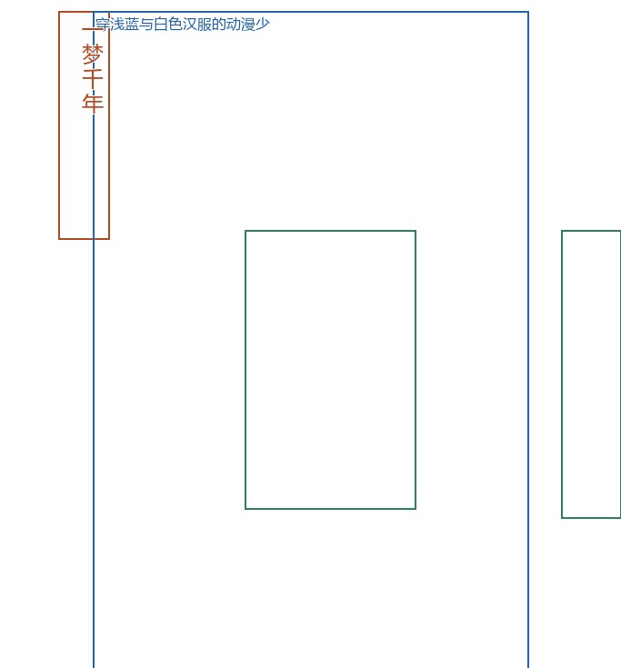
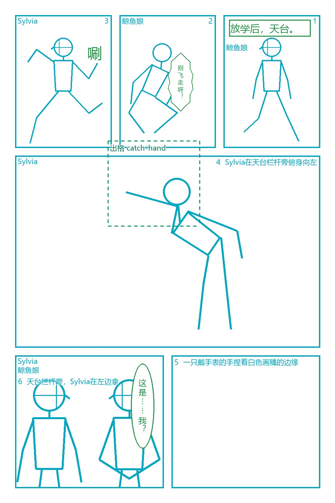

# 9. 导入别人的分镜

拿到别人的分镜文件后，可以先查看导入报告，了解工具读到了什么。文件中的尺寸、坐标格式和角色身份有时并不明确，导入器会尝试理解，并在报告里列出推断的部分，方便你核对后继续编辑。



图：一份外来 MOSS JSON 的离线预览局部，显示了单画布上的布局框。原文件没有漫画格，因此保留为单画布；超出画布的框在预览中会被裁切，原始 bbox 仍然保留。

## MOSS JSON 和单画布

不带项目参数运行导入命令，可以只读查看报告：

```powershell
soda-storyboard import external.json --json
```

报告里的宽高、格数和未知条目核对好后，加上项目和页面参数，就能保存进项目：

```powershell
soda-storyboard import external.json --project my-project --page-id imported --json
```

网页导入弹窗使用同一套导入器。如果 MOSS 文件没有写尺寸，导入器会根据坐标范围的纵横比，选取最接近的常用画布：1024×1536、1536×1024、1024×1024、768×1344 或 1344×768。归一化或空布局会回退到 1024×1536。这样可以先得到一份可检查的布局，原稿尺寸仍需要你确认。

没有格子时，导入页会使用 `canvas_mode: single`，保留文字、物件和人物框。其中 `character` 表示人物区域和描述，不包含可直接使用的角色身份或骨架关节。

`moss_import` 会记录原条目、顺序和未知字段。保留这段来源数据后，未编辑的条目可以按原样编译回去，编辑过的元素则由当前格式重新输出。清理 JSON 时也需要保留它。

## 其他 JSON 或 Markdown

导入器也接受常见 `frames`、`shots`、`panels`，以及 `prompt`、`description`、对白列表等宽松写法：

```powershell
soda-storyboard import external.md --project my-project --page-id imported-page --json
```

导入器会尝试识别不同的坐标顺序和归一化范围。坐标有歧义、未知字段较多，或者文本写法比较自由时，需要逐格核对报告。Markdown 中已有的分镜描述可以用来导入；一段任意小说文本则未必能自动得到合适的几何布局。

如果还没开始写，可以把 [给其他 AI 的格式说明](../for-other-ai.md) 发给对方 AI，让它按约定输出。文档里有可复制的提示词和完整示例，能帮助它组织出容易导入的结构；剧情与镜头仍需要你核对。

## 从颜色分镜图导入

自己的草图可以用颜色标记框的位置：青框是格子，绿框是文字，红色大框表示主角区域，红色横框可以表示标题。下面的命令会提取这些框位：

```powershell
soda-storyboard layout extract reference.webp --mode color --preview my-project/previews/import-overlay.png --json
```



图：按颜色约定绘制的本地草稿。工具提取的是框的几何位置，不会 OCR 识别文字；原文和画面内容由插件 AI 看图补入。

接下来，把原图和识别叠加图一起给插件，告诉它“按识别坐标填内容，不要重画框的位置”。AI 会补充每格画面和文字，展示新的草稿，等你确认后再翻译、编译。尤其要核对台词：提取到文字框的位置，只表示找到了框，里面的原文还需要看图补上。

## 从喜欢的漫画页提取版式

从漫画页提取版式时，使用 `--mode standard`。核对识别叠加图中的格子和阅读顺序后，保留 `--mode standard`，加上 `--save --name <模板名> --project my-project` 保存模板。当前 `color --save` 有已知报错，而 `auto` 可能自动切到颜色模式，因此保存模板时也需要明确指定 standard。

叠加图里的橙色虚线表示不确定的框，需要手动核对。无框构图、遮挡、嵌入格、浅色边框和重叠都可能影响识别，包含重叠的模板也可能无法通过后续布局校验。保存的模板只包含几何、来源文件名和识别日期，原图不会保存在模板中。

[下一章：常见问题与已知限制](10-troubleshooting.md) · [返回目录](README.md)
